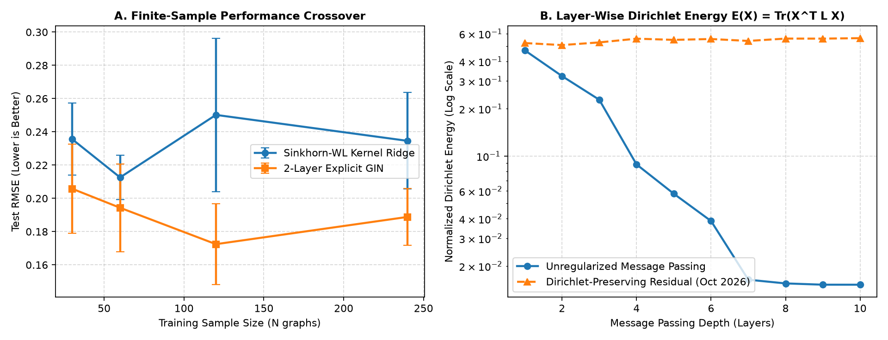

# finite-sample variance, spectral oversmoothing, and size-induced distribution shift

Message-passing layers (GCN, GIN, GraphSAGE) and an optimal-transport graph kernel, written by hand in PyTorch, NumPy and SciPy and compared on synthetic stochastic block model graphs. There is no torch_geometric or DGL anywhere in the code.

I started this because two questions kept coming up while reading GNN benchmark papers. In the small-data regime, how does a trained message-passing network compare with a closed-form kernel method, in error and in seed-to-seed spread? And how much of the reported error survives if train and test graphs differ in size instead of being split at random? The data are synthetic on purpose: the target function is known, and nothing about the split is accidental.

Work in progress, started June 2026. All results are from five seeds, and I say below where that is not enough.

## Setup

Python 3.13 (the runs here used 3.13.3 on Windows).

```bash
pip install -r requirements.txt
python -m pytest -v                    # gradient and equivariance checks
python -m experiments.run_benchmarks   # reruns the experiments, rewrites figures/results_oct2026.png
```

## What is implemented

Notation: a graph has $n$ nodes, adjacency $A$, degree matrix $D$ and features $X \in \mathbb{R}^{n \times d}$. I write $\tilde S = \tilde D^{-1/2}(A+I)\tilde D^{-1/2}$.

### Layers (`src/operators.py`)

GCN: $Y = \tilde S X W + \mathbf 1 b^\top$. The backward pass is written out by hand in a `torch.autograd.Function` instead of being left to autograd. For an upstream gradient $G = \partial \mathcal L / \partial Y$:

$$\frac{\partial \mathcal L}{\partial X} = (\tilde S^\top G) W^\top, \quad \frac{\partial \mathcal L}{\partial W} = X^\top \tilde S^\top G, \quad \frac{\partial \mathcal L}{\partial b} = G^\top \mathbf 1, \quad \frac{\partial \mathcal L}{\partial \tilde S} = G (XW)^\top$$

GIN: $H' = \mathrm{MLP}\big(((1+\epsilon) I + A) H\big)$ with learnable $\epsilon$.

GraphSAGE (mean aggregator): $H' = H W_{\text{self}} + (D^{-1} A H) W_{\text{neigh}}$.

### Kernel (`src/kernels.py`)

Each graph is turned into node embeddings by stacking diffusion steps, in the spirit of Weisfeiler-Lehman refinement:

$$\Phi_K = [\, X \;\|\; \tilde S X \;\|\; \dots \;\|\; \tilde S^K X \,] \in \mathbb{R}^{n \times (K+1)d}.$$

The rows of $\Phi_K$ are treated as a uniform empirical measure. For two graphs, the ground cost is $C_{pq} = \|\Phi_K(G_A)_p - \Phi_K(G_B)_q\|^2$ and the entropic transport problem is

$$\mathcal W_\varepsilon = \min_{\Pi \in U(\mu,\nu)} \langle \Pi, C\rangle + \varepsilon \sum_{pq} \Pi_{pq}(\log \Pi_{pq} - 1),$$

solved with Sinkhorn-Knopp scaling ($u \leftarrow \mu / Kv$, $v \leftarrow \nu / K^\top u$, $K = e^{-C/\varepsilon}$, stabilised as in the code). I use the plain entropic cost, not the debiased Sinkhorn divergence, so $\mathcal W_\varepsilon(G,G) \neq 0$ in general. The Gram matrix is $\mathcal K_{ij} = \exp(-\gamma\, \mathcal W_\varepsilon(G_i, G_j))$ and kernel ridge regression is solved in closed form:

$$\hat\alpha = (\mathcal K_{\text{train}} + \lambda I)^{-1} y_{\text{train}}, \qquad \hat y_{\text{test}} = \mathcal K_{\text{test,train}} \hat\alpha .$$

### Dirichlet energy

To watch oversmoothing I track $\mathcal E(H) = \frac1n \mathrm{tr}(H^\top L H)$ with $L = I - D^{-1/2} A D^{-1/2}$. Written over edges this is $\frac{1}{2n}\sum_{u,v} A_{uv}\, \| H_u/\sqrt{d_u} - H_v/\sqrt{d_v} \|^2$, with the sum over ordered pairs.

## Checks

Every layer goes through two checks in float64:

1. Central finite differences with step $10^{-6}$ against the analytical gradient, relative error below $10^{-6}$.
2. Node-permutation equivariance, $f(PX, PAP^\top) = P f(X, A)$, to about $10^{-12}$. The Dirichlet energy is checked to be invariant under relabelling.

Seven tests in `tests/test_rigor.py`, all passing (1.27 s on my machine).

## Data

Two-block SBM with homophily $\rho \in [0,1]$ and $n \sim \mathcal U(n_{\min}, n_{\max})$. Edge probabilities are $p_{\text{in}} = 0.45\rho + 0.10$ and $p_{\text{out}} = 0.45(1-\rho) + 0.05$. Node features in $\mathbb{R}^4$ have block-dependent means $(2c_i - 1)\,[1.0, -0.8, 0.5, 0.3]^\top$ plus $\mathcal N(0, 0.4^2 I)$ noise. The regression target is

$$y(G) = \frac1n \sum_i \Big( \sin\big((\tilde D^{-1}AX)_{i,0}\big) + \tfrac12 (\tilde D^{-1}AX)_{i,1}^2 \Big) + 0.8\,\frac{\mathbf 1^\top A \mathbf 1}{n^{1.5}} + \epsilon, \qquad \epsilon \sim \mathcal N(0, \sigma^2).$$

The first part depends on neighbourhood-averaged features. The second is a global size term; at fixed edge density it grows roughly like $\sqrt n$.

## Experiments

### 1. Small-sample comparison

Test set: 50 graphs, $n \in [12, 24]$, $\rho = 0.75$, $\sigma = 0.15$. KRR hyperparameters ($\gamma \in \{0.1, 0.3, 0.6\}$, $\lambda \in \{10^{-2}, 10^{-1}, 0.5\}$) are picked on an internal 80/20 split. The GIN has two layers, hidden size 24, AdamW with weight decay $10^{-3}$, and sees the same training graphs. Test RMSE, mean ± std over five seeds:

| N train | Sinkhorn-WL KRR | 2-layer GIN | std ratio (GIN / KRR) |
|---|---|---|---|
| 30 | 0.2356 ± 0.0217 | 0.2058 ± 0.0268 | 1.24 |
| 60 | 0.2126 ± 0.0133 | 0.1943 ± 0.0264 | 1.98 |
| 120 | 0.2502 ± 0.0461 | 0.1725 ± 0.0244 | 0.53 |
| 240 | 0.2346 ± 0.0290 | 0.1888 ± 0.0170 | 0.59 |

The GIN has the lower mean error at every size. At $N = 60$ the seed-to-seed standard deviation of the GIN is about twice that of the KRR, but I would not read much into it. With five seeds an F-test on that ratio gives $p \approx 0.2$, and at $N = 120$ the ratio goes the other way. Also, the KRR error is not monotone in $N$ (0.2126 at 60, 0.2502 at 120). My guess is a mix of hyperparameter selection on one small validation split and a Gram matrix that is not guaranteed to be positive semidefinite (see below), but I have not checked either.

### 2. Random split versus size-grouped split

180 graphs with $n \in [10, 32]$, 130 for training and 50 for testing. Random split: train and test both drawn from $[10, 32]$. Grouped split: train on $n \in [10, 24]$, test on $n \in [25, 32]$.

| split | 2-layer GIN | Sinkhorn-WL KRR |
|---|---|---|
| random | 0.1746 | 0.2180 |
| grouped | 0.3043 (+74.3%) | 0.3611 (+65.6%) |

For the GIN I report 0.3043 as the generalisation figure; the random-split number is optimistic.

Both models degrade, and I have two untested explanations that are different for each. For the GIN, sum aggregation makes pre-activations scale with degree, and degree grows with $n$, so larger test graphs may push the MLP outside the range it saw in training. For the kernel, a uniform empirical measure does not encode $n$: duplicate every node $k$ times and the measure is unchanged, so the transport cost cannot see graph size, while the target has a size term. A clean test would be to remove the size term from the target and see whether the kernel's degradation disappears. I have not run that.

One more caveat on this table. Because the size term grows with $n$, the target's own scale is different on the larger test graphs, so RMSE is not directly comparable across the two splits. A mean-predictor baseline on the grouped test set is needed and is not here yet.

### 3. Oversmoothing

Without any correction, the Dirichlet energy of the hidden states decays roughly exponentially over depths 1 to 10 (figure, panel B). An initial-residual connection,

$$H^{(l)} = (1-\alpha)\,\sigma(\tilde S H^{(l-1)} W) + \alpha H^{(0)}, \qquad \alpha = 0.18,$$

keeps the energy away from zero over the same ten layers. This is the idea from GCNII, applied here without the identity-mapping part. The figure uses $\alpha = 0.18$ only.



## Known issues

- Five seeds per setting, no confidence intervals beyond the one F-test above.
- $\exp(-\gamma \mathcal W_\varepsilon)$ is not guaranteed to be a positive semidefinite kernel. I add $\lambda I$ but do not project or correct the Gram matrix.
- KRR hyperparameters come from a single 80/20 split.
- Synthetic data only. The target was written by me, so "GIN does better at small $n$" is partly a statement about my target, and I have not tested why.
- No mean-predictor or constant baseline in the grouped-split experiment, and no ablation of the size term.

## In progress

Replacing the uniform marginals with degree-weighted unbalanced OT so the kernel can see graph size, and the size-term ablation above.
